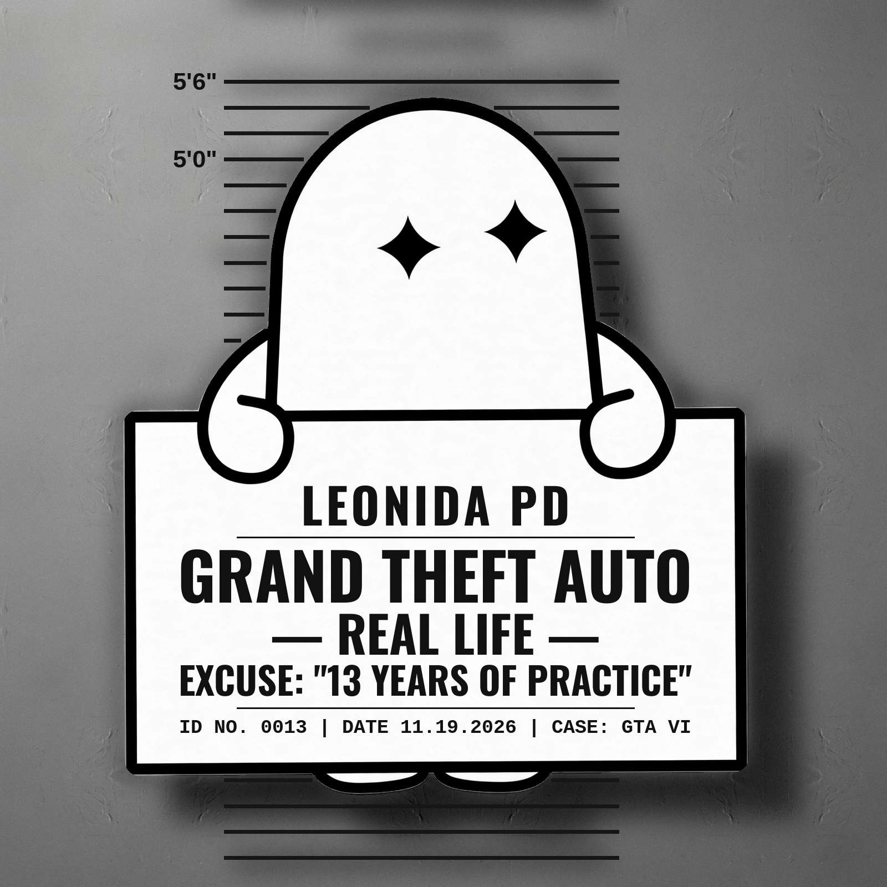

# Booked in Leonida

A GTA 6 meme entry for the [make.fun bounty “Post a GTA 6 meme on X”](https://make.fun/bounty/gta6-meme-x-01).

[](https://make.fun/bounty/gta6-meme-x-01?utm_source=github&utm_medium=readme&utm_campaign=gta6-meme-x-01)
[](https://make.fun/bounty/gta6-meme-x-01/leaderboard?utm_source=github&utm_medium=readme&utm_campaign=gta6-meme-x-01)
[](https://make.fun/bounty/gta6-meme-x-01?utm_source=github&utm_medium=readme&utm_campaign=gta6-meme-x-01)

## The meme



The ghost is booked and measured at roughly 5'2"—Leonida has its suspect.

## The entry

The entry is the [X post by @cv_sar](https://x.com/cv_sar/status/2124031573620302245). `POST.json` names that post, and `main.ts` validates its URL before copying the file to the output directory for the gate.

## How it was made

The ghost mascot reference came from make.fun’s press kit. A photorealistic mugshot scene was generated around the flat mascot; the placard text was typeset afterward in Oswald Bold. The height chart was rebuilt on a clean wall plate so its ticks are even and the ghost measures about 5'2".

## Run

```sh
mkdir -p out && MAKEFUN_BOT_DIR=. MAKEFUN_OUTPUT_DIR=out node main.ts
```

Try make.fun via [this referral link](https://make.fun/r/gbkqf2br).
